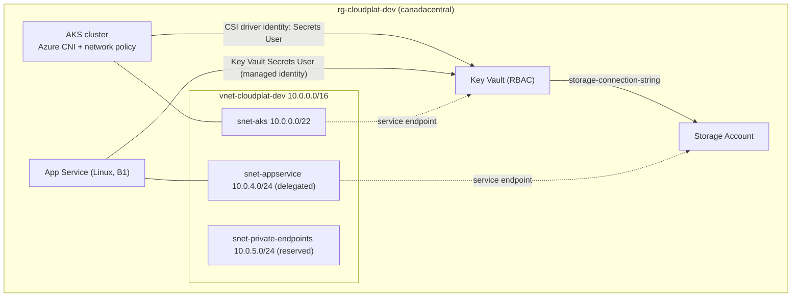
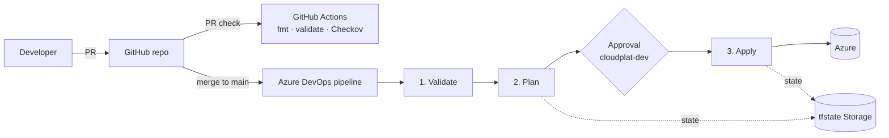

# Cloud Platform on Azure — Terraform + Azure DevOps + GitHub

Modular Terraform that deploys a secure Azure foundation in `canadacentral`:

| Component | Purpose | Module |
|---|---|---|
| Resource Group | Organize Azure resources | `modules/resource-group` |
| Networking | VNet + dedicated subnets (AKS, App Service, private endpoints) + NSGs | `modules/networking` |
| App Service | Linux web app, VNet-integrated, Key Vault references | `modules/app-service` |
| AKS | Kubernetes with Azure CNI, workload identity, Key Vault CSI driver | `modules/aks` |
| Key Vault | RBAC-mode secrets management | `modules/key-vault` |
| Storage | StorageV2 account with private containers, versioning, soft delete | `modules/storage` |

Code lives in **GitHub**. **GitHub Actions** gives fast PR feedback (fmt, validate, Checkov). **Azure DevOps** deploys (plan → approval → apply) using a workload-identity-federation service connection — no secrets stored anywhere.

## Architecture



## CI/CD flow



## Project structure

```
cloud-platform/
├── .github/workflows/terraform-ci.yml   # GitHub PR checks
├── pipelines/
│   ├── azure-pipelines.yml              # Azure DevOps deploy pipeline
│   └── templates/terraform-install.yml
├── scripts/bootstrap-tfstate.sh         # one-time remote state setup
└── infra/
    ├── providers.tf  backend.tf  main.tf  variables.tf  outputs.tf
    ├── environments/dev.tfvars  dev.backend.hcl
    └── modules/ resource-group  networking  app-service  aks  key-vault  storage
```

## Setup — step by step

### 1. Prerequisites
- Azure subscription with Owner (or Contributor + User Access Administrator)
- Azure CLI, Terraform ≥ 1.6, Git
- Azure DevOps organization + project, GitHub account

### 2. Bootstrap remote state (one time)
```bash
az login
az account set --subscription "<SUBSCRIPTION_ID>"
./scripts/bootstrap-tfstate.sh
```
Copy the printed values into `infra/environments/dev.backend.hcl`.

### 3. Push to GitHub
```bash
git init && git add . && git commit -m "Initial Azure platform"
git branch -M main
git remote add origin https://github.com/Jurassic55/cloud-platform-terraform.git
git push -u origin main
```

### 4. Create the Azure DevOps service connection
Project settings → Service connections → New → **Azure Resource Manager** → **Workload identity federation (automatic)** → scope: Subscription → name it **`azure-terraform-service-connection`**.

### 5. Grant the service connection RBAC rights
Terraform creates role assignments (Key Vault, AKS subnet), so Contributor alone is not enough:
```bash
SP_ID="<service-connection app (client) id>"
SUB="/subscriptions/<SUBSCRIPTION_ID>"
az role assignment create --assignee "$SP_ID" --role "Contributor" --scope "$SUB"
az role assignment create --assignee "$SP_ID" --role "User Access Administrator" --scope "$SUB"
```

### 6. Create the approval environment
Pipelines → Environments → New → **`cloudplat-dev`** → Approvals and checks → add yourself as approver.

### 7. Create the pipeline from GitHub
Pipelines → New pipeline → **GitHub** → authorize → pick the repo → **Existing YAML** → `/pipelines/azure-pipelines.yml` → Run.

### 8. Protect `main` in GitHub (optional, recommended)
Settings → Branches → require the `fmt + validate` check before merging.

### 9. Verify the deployment
```bash
az aks get-credentials --resource-group rg-cloudplat-dev --name aks-cloudplat-dev
kubectl get nodes
az webapp show -g rg-cloudplat-dev -n <app-name> --query defaultHostName -o tsv
az keyvault secret list --vault-name <kv-name> -o table
```

### 10. Local runs (optional)
```bash
cd infra
terraform init -backend-config=environments/dev.backend.hcl
terraform plan -var-file=environments/dev.tfvars
```
Commit the generated `.terraform.lock.hcl`.

## Naming (globally unique names use a `random_string` suffix)

| Resource | Pattern |
|---|---|
| Resource group | `rg-cloudplat-dev` |
| VNet / subnets | `vnet-cloudplat-dev` / `snet-aks`, `snet-appservice`, `snet-private-endpoints` |
| App Service | `asp-cloudplat-dev`, `app-cloudplat-dev-<suffix>` |
| AKS | `aks-cloudplat-dev` |
| Key Vault | `kv-cloudplat-dev-<suffix>` |
| Storage | `stcloudplatdev<suffix>` |

## Security notes
- No secrets in pipelines: OIDC federation for Azure DevOps.
- Key Vault in RBAC mode; App Service and the AKS CSI driver read secrets via managed identity.
- Storage connection string lives only in Key Vault; App Service references it with `@Microsoft.KeyVault(...)`.
- TLS 1.2 minimum, HTTPS-only, FTPS disabled, no public blob access.
- `network_default_action = "Allow"` keeps Microsoft-hosted agents working. For production, set `Deny`, add private endpoints in `snet-private-endpoints`, and use a self-hosted agent inside the VNet.

## Troubleshooting
| Symptom | Fix |
|---|---|
| `403 Forbidden` writing the Key Vault secret | RBAC still propagating — re-run; increase `create_duration` in `modules/key-vault` |
| `AuthorizationFailed` on role assignment | Step 5 — service connection needs User Access Administrator |
| Key Vault name already exists | Soft-deleted vault — `az keyvault purge --name <kv>` or change `project` |
| AKS quota error | Change `aks_node_vm_size` or request quota in canadacentral |
| OIDC token expired on long applies | Re-run apply; or switch to `ARM_ADO_PIPELINE_SERVICE_CONNECTION_ID` token refresh |

## Cost & cleanup
AKS nodes (D2s_v5) and the B1 plan are the main costs. Tear down when done:
```bash
cd infra
terraform destroy -var-file=environments/dev.tfvars
```

## Next steps
1. Add ACR + `AcrPull` on the AKS kubelet identity
2. Private endpoints for Key Vault and Storage
3. Log Analytics + Container Insights
4. `test` / `prod` tfvars with multi-stage pipeline
